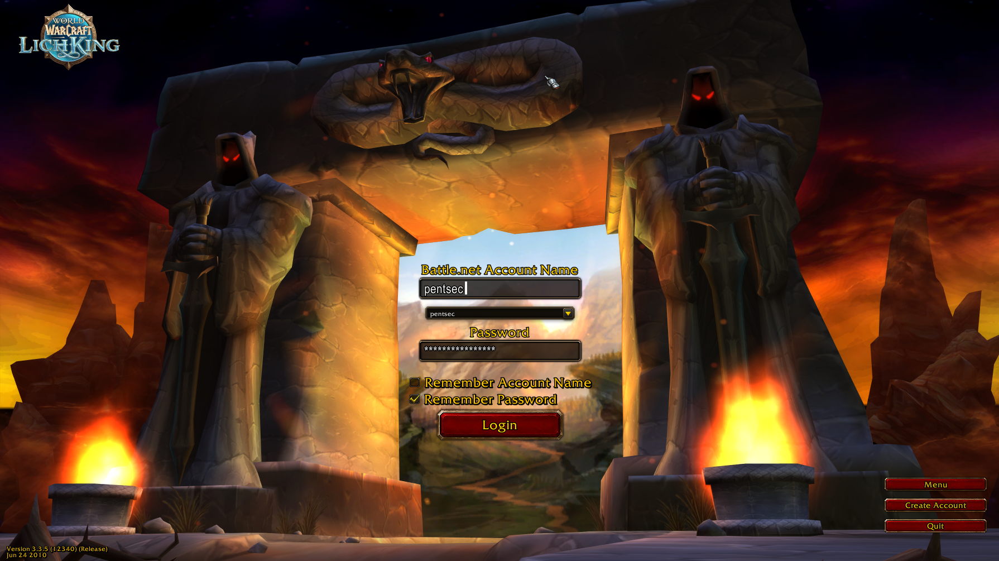
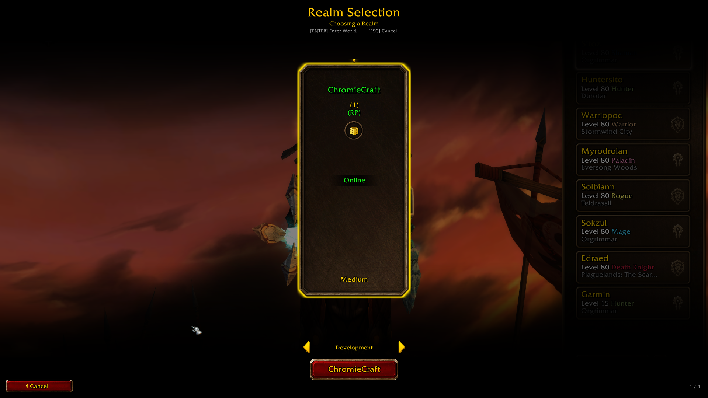
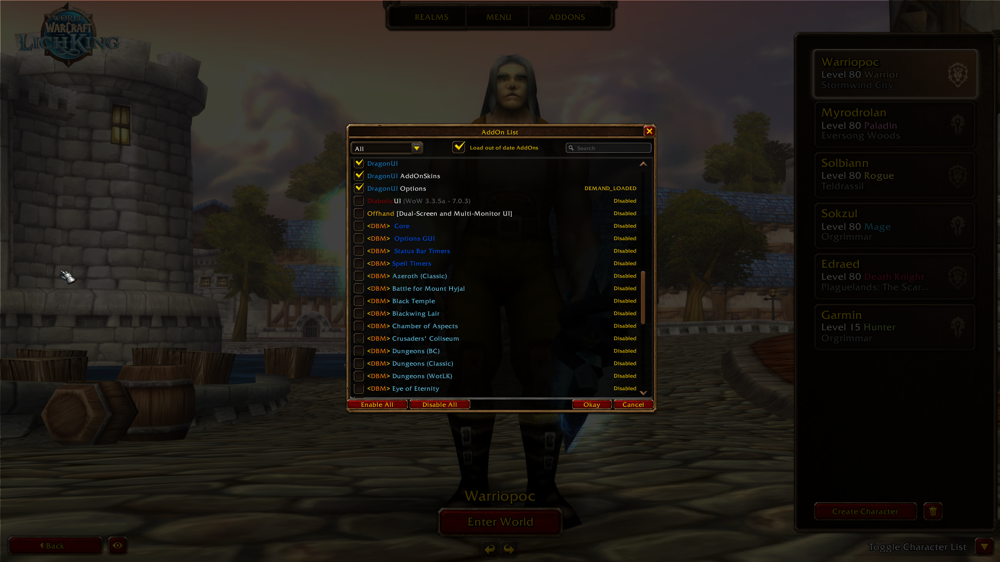
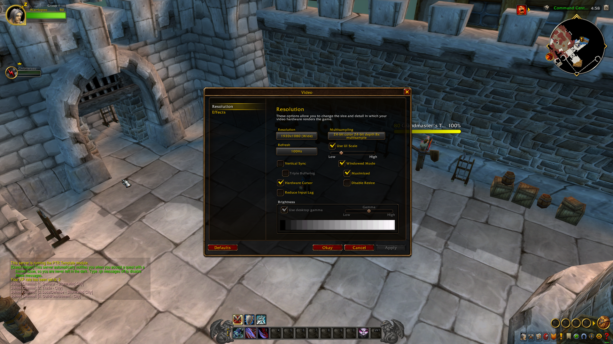
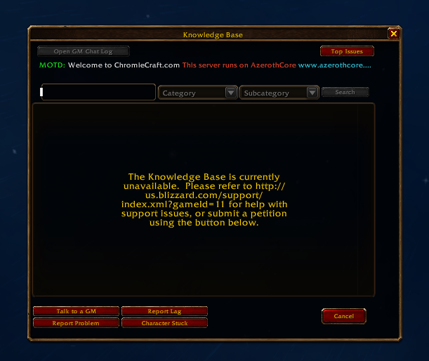
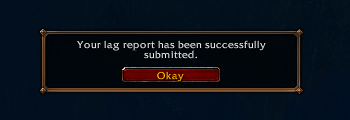

 

# ForeverLogin

Click for previews

Account login, realm list, addon list, and the windows inside the game.

A hand built replacement for the World of Warcraft 3.3.5a client interface - both
the glue screens you see before the game and the windows inside it. Login, realm
list, character select and creation, the addon list, options, credits and
cinematics, plus the Esc menu, the video, sound and interface options, the key
bindings, the Help and Knowledge Base windows and the confirmation popups, all
drawn over the client's own `GlueXML` and `FrameXML`.

## What it is

The client ships its glue screens as `Interface/GlueXML`. This project takes them
over: `GlueXML.toc` keeps the client's files for the parts it uses (strings,
fonts, base controls) and, from `ForeverLogin.xml` on, every screen is built
here, in the client's own art style and with its own strings.

Nothing about the game logic is reimplemented. The screens drive the client's
hidden buttons and read its state, so CVars, character data, addon loading,
realm connecting and the movie list all stay under the client's control.

## Screens

| Screen | What it does |
| --- | --- |
| Account login | Fields, the saved accounts dropdown, and the menu button the 3.3.5 client does not have |
| **Realm list** | A realm list built from scratch (see below) |
| Character select | A scrolling list of our own character cards; 3.3.5 has none |
| Character create | Step 1 picks race, class and body, step 2 customizes and names |
| Addon list | Over the client's data, with a search box and its own rows |
| Options | The Options menu and the Video and Sound windows, laid out over the client's CVars |
| Credits | Over the client's credits text and music, with key art per expansion |
| Cinematics | The client's movies, newest first, three columns on one page |
| Main menu | The glue screens' menu, with a veil that blocks the screen behind |

### The login screen

The client's own saved account list dropdown is replaced by ours, between the
account and the password fields:

- every account logged into is kept, newest first, up to eight, each with its
  password when "remember password" was ticked
- picking an account fills both fields; picking one while a check box that
  matters is unticked says so first, above the account field, naming the box to
  tick
- the list is the client's own saved account list, the `accountList` CVar of
  `Config.wtf`, so it survives restarts; a glue screen cannot register a CVar of
  its own
- with nothing saved the dropdown stays away and the fields close up, the way
  the client does with its own list

### The realm list

The client's `RealmList.xml` is no longer loaded: its frame is ours.

- a row of realm **cards** - the client's own mode-selection art, with a state
  ribbon across the middle (Online, Offline, Locked, Full) and a badge for the
  realm type
- the **category** in a button with an arrow either side, instead of a row of
  tabs
- a single **action button** that enters the focused realm; it lights up only
  when there is a realm to enter, and names the realm it will enter
- a **selection pointer** over the focused card, hover zoom, page arrows and the
  wheel, keyboard focus with the arrow keys, Enter to enter and Escape to cancel
- the row is centred while the realms fit on screen, and scrolls once they do not

## Requirements

- A World of Warcraft **3.3.5a** client, or a 3.3.5 based client that loads the
  classic glue interface. The screens are written against the 3.3.5 API and the
  client's own glue strings, so no extra libraries are needed.

## HD textures

The screens have been tested with the latest HD texture pack for 3.3.5 and the
install guide from [Project Reforged](https://projectreforged.github.io/wotlk/downloads/).

## Repository layout

| Path | Contents |
| --- | --- |
| `Interface/GlueXML/` | The login screens, the shared base, the atlas table and the texts |
| `Interface/FrameXML/` | The in game windows (Esc menu, options, key bindings, help, popups) and the toc they are listed in |
| `Interface/ForeverLogin/` | The texture pack: the `.blp` files, in the client's folder structure |
| `preview/` | The screenshots shown at the top of this README |

The texture pack is part of the project, not an optional download: the screens
draw every panel, button and icon from it.

Nothing here is an addon. The client's `GlueXML` and `FrameXML` are loaded from
`Interface/GlueXML` and `Interface/FrameXML` at startup, and both toc files list
the client's own files first and ours at the end: the screens replace art and
hooks, and never appear in the addon list, because there is no addon.

## How it works

- **The atlas table.** `ForeverLoginAtlas.lua` maps the name of every piece the
  screens use to its file, its texcoords and its size - 245 entries - so a
  texture is placed exactly as the client places its own atlases, without
  depending on the client having one.
- **The texts.** Where the client has a string, that string is used. Everything
  else lives in `ForeverLoginTexts.lua` and a file per client locale - `deDE`,
  `enUS`, `esES`, `esMX`, `frFR`, `koKR`, `ptBR`, `ruRU`, `zhCN` and `zhTW` -
  with English as the fallback, so nothing is hardcoded.
- **The scale.** The glue area is scaled from the screen height and the screens
  are laid out in reference units. A fitting pass on each screen grows the
  reference height when blocks would overlap on a short screen.
- **The templates.** The shared base holds the reusable pieces - atlas
  placement, nine slice frames, three slice buttons, windows, insets, dialogs,
  dropdowns - so the screens describe layout, not art.

## Notes

- The pack's textures are binary and stay in the repository, so adding or
  replacing art grows the history; keep new textures close to what the client
  needs.
- The realm list is the most developed screen here; the other screens tend to
  stay close to the client's own layout, restyled.

## Credits

- Art extracted from the game's own assets. World of Warcraft and all related
  artwork are trademarks and copyrights of Blizzard Entertainment. This is a fan
  project, not affiliated with or endorsed by Blizzard.

## License

MIT - see [LICENSE](LICENSE).
